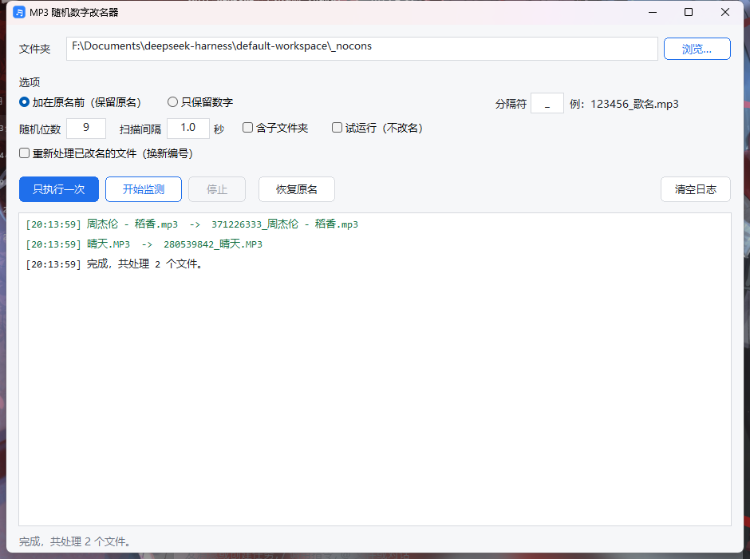

# MP3 随机数字改名器

把 mp3 文件名改成**不重复的随机数字**（可选保留原名），用于打散/混淆音乐库的文件名，
或者让播放器按随机顺序排列。

```
周杰伦 - 稻香.mp3   →   612389034_周杰伦 - 稻香.mp3
```

三种界面、五个平台产物，全部来自**同一套核心逻辑**，并且共用一个状态文件——
换哪种界面都不会互相打架。



## 功能

| 功能 | 说明 |
|---|---|
| 随机前缀 | 数字加在原名前，后缀（含 `.MP3` 大小写）原样保留 |
| 只保留数字 | 丢掉原名，只留 `612389034.mp3` |
| 监测模式 | 常驻盯着文件夹，新丢进去的 mp3 立刻改名 |
| 不重复 | 进程内集合 + 状态文件，重启后也不会撞号 |
| 已改过的跳过 | 状态文件记着生成过的名字，不会每跑一次叠一层前缀 |
| 重新编号 | `--reprocess`：摘掉旧数字，按当前设置换新号（换位数、换分隔符） |
| 恢复原名 | 优先用记录精确还原；文件被手动改过名也能靠**内容指纹**认出来 |
| 试运行 | `--dry-run` 只打印，不动文件 |
| 写权限自检 | 开跑前真的建/改/删一次文件，权限不对直接给明确提示 |

## 三种形态

| 程序 | 平台 | 大小 | 说明 |
|---|---|---|---|
| `mp3rn-winningui.exe` | Windows | ~293 KB | 原生 Win32 窗口，扁平化界面，双击即用 |
| `mp3rn-gui.exe` | Win / Linux / Android | ~296 KB / 1.8 MB | 本地网页界面：起个只监听 `127.0.0.1` 的服务，用浏览器当界面 |
| `mp3rn.exe` | Win / Linux / Android | ~272 KB / 1.6 MB | 命令行，可脚本化 |

都是**静态编译、无运行时依赖**，拷到别的机器直接能跑（Linux/Android 版是静态 musl 二进制）。

## 用法

### 图形界面

双击 `mp3rn-winningui.exe` → 选文件夹 → 点「只执行一次」。
常驻监测点「开始监测」，「恢复原名」把改过的名字还原。

### 命令行

```bash
mp3rn "D:/Music" --once                      # 扫一遍
mp3rn "D:/Music"                             # 常驻监测，Ctrl+C 停止
mp3rn "D:/Music" --digits 6 --once           # 6 位数字
mp3rn "D:/Music" --sep= --once               # 不要分隔符
mp3rn "D:/Music" --once --reprocess          # 已改过名的重新编号
mp3rn "D:/Music" --restore --dry-run         # 预览恢复原名
mp3rn "D:/Music" --restore                   # 真的恢复
```

`--help` 看全部参数。

### 安卓（Termux）

```bash
termux-setup-storage
chmod +x mp3rn-android-arm64
./mp3rn-android-arm64 ~/storage/shared/Music --once
```

## 原理

### 不重复的编号

每次抽一个 `digits` 位的随机数，先查内存里的 `used` 集合，再查磁盘上是否已有同名文件；
成功后同时写进状态文件 `.mp3_random_renamer_state.json`（放在被处理的目录里）：

```json
{
  "used":  [612389034, 193250],
  "names": ["612389034_周杰伦 - 稻香.mp3"],
  "orig":  {"612389034_周杰伦 - 稻香.mp3": "周杰伦 - 稻香.mp3"},
  "fps":   {"a13165fb…": "周杰伦 - 稻香.mp3"}
}
```

- `used` —— 发过的号，保证不重复
- `names` —— 生成过的文件名，用来跳过已处理的文件
- `orig` —— 新名 → 原名，恢复时精确匹配
- `fps`  —— 内容指纹 → 原名，文件名被改过也能认出来

### 内容指纹

全量 SHA-256 对 8MB 的文件要 70ms，1000 首就是一分钟；所以只读**文件大小 + 首尾各 512KB**
（约 4ms/首）。同大小且首尾都相同的，基本只能是同一份音频。

### 恢复原名的判断顺序

1. `orig` 里记的名字（最准）
2. 内容指纹（文件被改过名、或换过一轮编号）
3. 前缀推断：数字必须是发过的号，且**位数 ≥ 6** 才敢摘
   （`01_序曲.mp3`、`2024_演唱会.mp3` 这种歌名自带的数字不会被误伤）

## 自己构建

只需要 [Zig](https://ziglang.org/download/)（单文件，免安装）：

```bash
# 一键构建全部产物（Windows 主机）
python _build/build_c.py

# 或者手动
zig cc -O2 -std=c11 -o mp3rn.exe mp3rn.c -lshell32
zig cc -O2 -std=c11 -target x86_64-linux-musl -static -o mp3rn-linux-x64 mp3rn.c
zig cc -O2 -std=c11 -target aarch64-linux-musl -static -o mp3rn-android-arm64 mp3rn.c
zig cc -O2 -std=c11 -o mp3rn-gui.exe mp3rn_gui.c -lshell32 -lws2_32
zig cc -O2 -std=c11 -Wl,--subsystem,windows -Wl,-e,mainCRTStartup \
       -o mp3rn-winningui.exe mp3rn_win32.c _build/app.res \
       -lshell32 -lole32 -lcomctl32 -luuid -lgdi32 -luser32
```

macOS 上用系统自带的 clang 即可：

```bash
cc -O2 -std=c11 -o mp3rn mp3rn.c
cc -O2 -std=c11 -o mp3rn-gui mp3rn_gui.c
```

改界面：编辑 `webui.html` 后跑 `python _build/embed_webui.py` 重新生成 `webui_html.h`。

Python 版（tkinter 界面 + 命令行）用 `_build/build_exe.py` 打包成 exe，需要先跑
`_build/fetch_wheels.py` 拉 PyInstaller。

## 目录

```
mp3rn.c              核心：扫描 / 改名 / 重新编号 / 恢复 / 状态文件 / JSON / SHA-256
mp3rn_win32.c        原生 Win32 界面（#include 上面的核心）
mp3rn_gui.c          本地网页界面（HTTP 服务 + 线程）
webui.html           网页界面（构建时编译进二进制）
webui_html.h         由 webui.html 生成的字节数组
mp3_random_renamer.py   Python 命令行版
mp3_renamer_gui.py      Python tkinter 界面版
_build/              构建脚本与图标
docs/                截图
```

## 注意

- 状态文件是恢复原名的唯一依据，**别删**。删了就只能靠“摘 ≥6 位前缀”，
  「只保留数字」模式改过的文件就真的回不去了。
- 随机数字位数默认 9，最少建议 6。设成 3 位只有 900 个号，库里文件多了会抽不出来。
- 程序只处理 `.mp3`（大小写不敏感），默认不递归子文件夹（界面/命令行都提供开关）。

## License

MIT（如需要其他协议请自行替换本段）。
